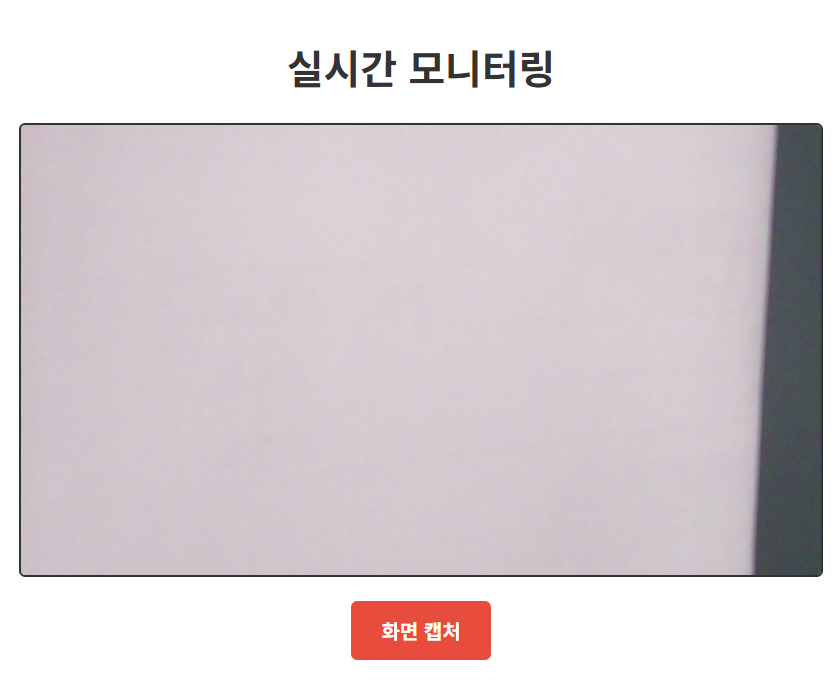
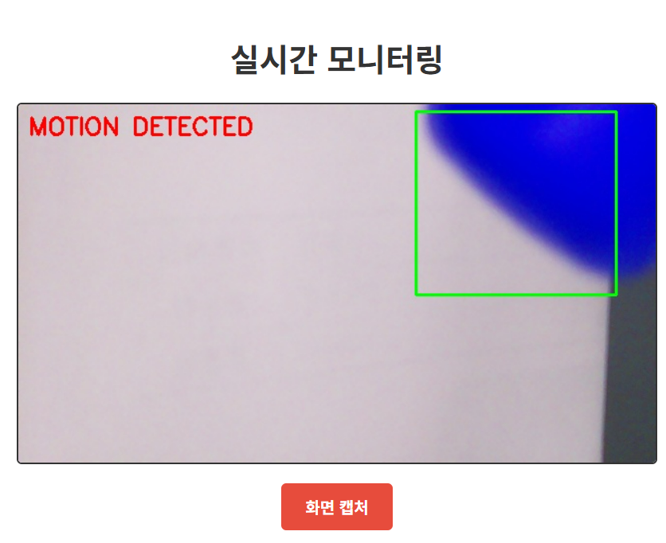
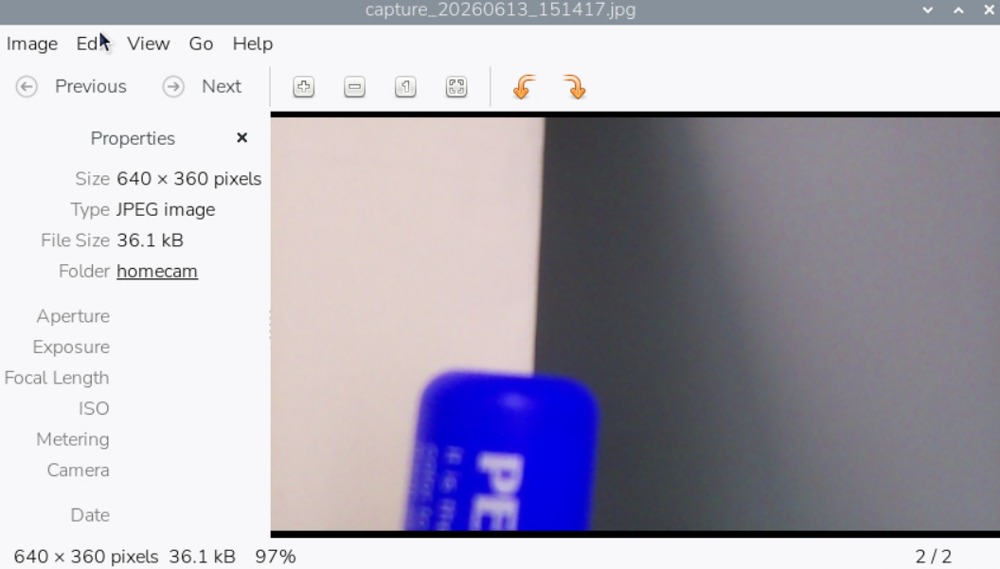

# 라즈베리파이 실시간 모니터링 시스템

> 라즈베리파이 카메라 영상에서 **차영상(frame difference)으로 움직임을 감지**하고, 스마트폰 웹 브라우저로 **실시간 스트리밍 확인 · 원격 캡처**하는 홈 CCTV


| 기간 | 인원 | 구분 |
| --- | --- | --- |
| 2026.03 ~ 2026.06 | 2명 | 신라대학교 인공지능학과 과제 |

| 평상시 | 움직임 감지 | 원격 캡처 저장 |
| --- | --- | --- |
|  |  |  |

## 목차
1. [주요 기능](#1-주요-기능)
2. [시스템 구성](#2-시스템-구성)
3. [움직임 감지 파이프라인](#3-움직임-감지-파이프라인)
4. [설계 포인트](#4-설계-포인트)
5. [실행 방법](#5-실행-방법)
6. [트러블슈팅](#6-트러블슈팅)
7. [개선 계획](#7-개선-계획)

---

## 1. 주요 기능
- **실시간 스트리밍**: 같은 네트워크의 스마트폰·PC 브라우저에서 카메라 화면을 실시간으로 확인 (MJPEG)
- **움직임 감지**: 움직인 물체에 초록 박스를 그리고, 화면 좌측 상단에 `MOTION DETECTED` 표시
- **원격 캡처**: 웹의 [실시간 화면 캡처] 버튼을 누르면 라즈베리파이에 현재 화면을 `capture_YYYYMMDD_HHMMSS.jpg`로 저장

## 2. 시스템 구성

```
[Pi 카메라] ──▶ camera.py ──▶ app.py (Flask) ──▶ index.html (브라우저)
              움직임 감지      MJPEG 스트리밍       실시간 화면 + 캡처 버튼
              JPEG 인코딩      /capture 라우터  ◀── fetch('/capture')
```

| 파일 | 역할 |
| --- | --- |
| `camera.py` | `VideoCamera` 클래스: Picamera2 카메라 제어, 움직임 감지, JPEG 인코딩, 캡처 저장 |
| `app.py` | Flask 서버: 메인 페이지(`/`), 영상 스트림(`/video_feed`), 캡처 요청(`/capture`) |
| `templates/index.html` | 모바일 웹 화면: 실시간 영상 + 비동기 캡처 버튼 |

| 라우트 | 동작 |
| --- | --- |
| `GET /` | `index.html` 렌더링 |
| `GET /video_feed` | `multipart/x-mixed-replace` 응답으로 JPEG 프레임을 연속 전송 |
| `GET /capture` | 현재 프레임 저장 후 `{"status": "success", "filename": ...}` JSON 반환 |

## 3. 움직임 감지 파이프라인

```
① 프레임 입력 (640×360, XRGB8888)
② 4번째 채널(X) 제거 → BGR 변환
③ 흑백 변환 + 21×21 가우시안 블러
④ 직전 프레임과 차영상 (absdiff)
⑤ 임계값 25로 이진화 → 팽창(dilate) 2회
⑥ 외곽선 검출 → 면적 500px 미만 무시 → 박스 표시
⑦ JPEG 인코딩 → 브라우저로 전송
```

```python
frame_delta = cv2.absdiff(self.prev_frame, gray)            # 정지한 배경은 0, 움직인 영역만 남음
ret, thresh = cv2.threshold(frame_delta, 25, 255, cv2.THRESH_BINARY)
thresh = cv2.dilate(thresh, None, iterations=2)             # 찢어진 영역을 하나의 덩어리로
contours, _ = cv2.findContours(thresh, cv2.RETR_EXTERNAL, cv2.CHAIN_APPROX_SIMPLE)
```

## 4. 설계 포인트

| 결정 | 이유 |
| --- | --- |
| 딥러닝 탐지 대신 **차영상** | 라즈베리파이의 제한된 연산량에서 실시간성을 유지하기 위해, 학습 없이 픽셀 차이만으로 움직임 영역을 찾음 |
| **흑백 1채널**로 연산 | 움직임 판단에는 색이 필요 없으므로 명암만 사용해 연산량 감소 |
| **MJPEG 스트리밍** | Flask 제너레이터(`yield`)로 JPEG를 끊임없이 보내고, 브라우저는 `` 태그 하나로 영상을 표시. 별도 플레이어나 앱이 필요 없음 |
| 캡처는 **비동기 `fetch`** | 일반 링크는 페이지가 새로고침되며 스트림이 끊김. `fetch`로 캡처 명령만 보내 영상을 유지한 채 결과를 JSON으로 받음 |
| 파일명에 **촬영 시각** | `capture_20260613_151417.jpg`처럼 중복 없이 저장되고 시간순 정렬이 쉬움 |

## 5. 실행 방법

**필요 환경**: Raspberry Pi + 카메라 모듈, Raspberry Pi OS (Picamera2 지원 버전)

```bash
sudo apt install -y python3-picamera2
pip install -r requirements.txt
python app.py
```

같은 Wi-Fi에 연결된 스마트폰이나 PC 브라우저에서 `http://<라즈베리파이 IP>:8080`으로 접속합니다.

> 카메라 하드웨어(Picamera2)가 필요해 일반 PC에서는 실행되지 않습니다. 동작 화면은 위 시연 이미지를 참고해 주세요.

### 폴더 구조
```
├── app.py               # Flask 웹 서버 (스트리밍·캡처 라우터)
├── camera.py            # 카메라 제어 + 움직임 감지 + 캡처
├── templates/
│   └── index.html       # 모바일 웹 화면
├── requirements.txt
└── docs/images/         # README 시연 이미지
```

## 6. 트러블슈팅

### ① 카메라 프레임을 OpenCV가 처리하지 못함
- **문제**: 카메라에서 받은 프레임을 그대로 OpenCV 함수에 넣으면 색상 변환과 처리가 정상적으로 동작하지 않았습니다.
- **원인**: Picamera2 출력 포맷이 XRGB8888(4채널)이라, OpenCV가 기대하는 3채널 이미지와 맞지 않았습니다.
- **해결**: 필요 없는 4번째 채널을 `image[:, :, 0:3]`으로 잘라낸 뒤 처리했습니다.

### ② 움직임이 없는데 감지가 뜸
- **문제**: 정지 화면에서도 조명 미세 변화나 센서 노이즈 때문에 움직임이 오감지되었습니다.
- **해결**: 21×21 가우시안 블러로 미세 노이즈를 평활화하고, 차영상 임계값 25로 이진화한 뒤 면적 500px 미만 외곽선은 무시했습니다.
- **결과**: 정지한 배경은 0으로 지워지고 실제로 움직인 물체 영역만 박스로 표시되었습니다.

### ③ 서버 실행 시 카메라 자원 충돌
- **문제**: Flask 디버그 모드로 실행하면 카메라를 열 때 자원 선점 충돌 오류가 발생했습니다.
- **원인**: 디버그 모드의 자동 재로딩(reloader)이 서버 프로세스를 이중으로 띄워, 두 프로세스가 같은 카메라를 동시에 열려고 했습니다.
- **해결**: `app.run(..., debug=True, use_reloader=False)`로 재로딩을 끄고 카메라가 한 프로세스에서만 열리도록 했습니다.

## 7. 개선 계획
- **색상 채널 순서 재검증**: Picamera2의 XRGB8888 배열은 메모리상 B, G, R 순서로 나오는 것으로 알려져 있어, 현재의 `COLOR_RGB2BGR` 변환이 빨강·파랑을 뒤바꿀 가능성이 있음 → 실기기에서 재확인 필요
- 움직임 감지 시 자동 캡처 · 스마트폰 알림 전송
- 경량 객체 탐지 모델로 사람/물체 구분
- 여러 브라우저가 동시에 접속할 때를 대비해 프레임 처리를 별도 스레드로 분리
